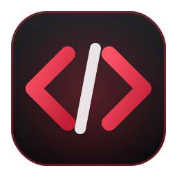
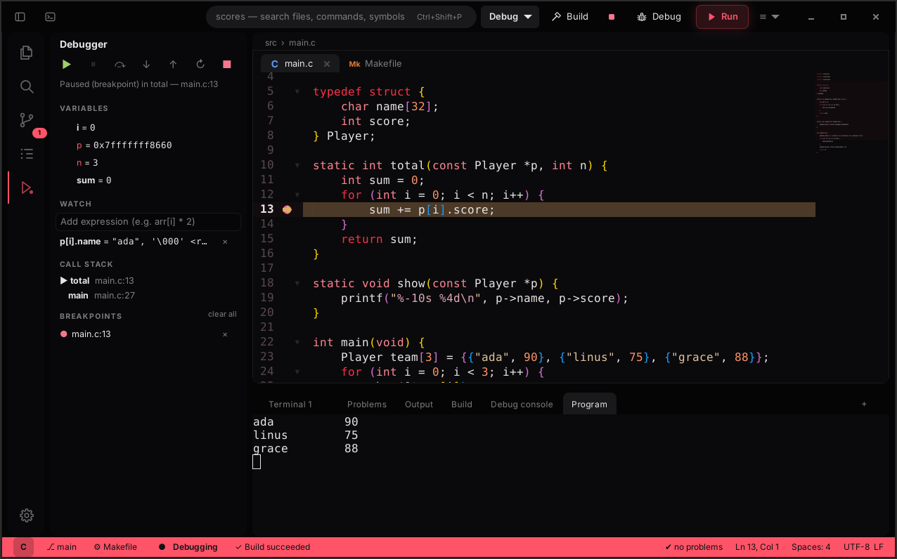
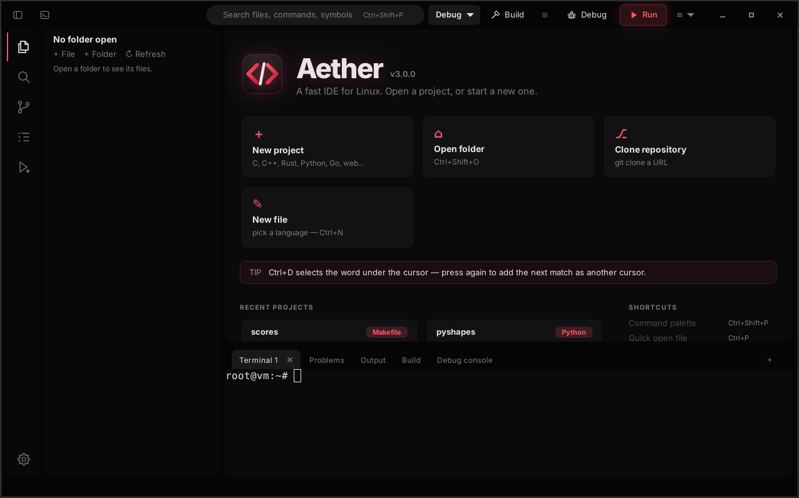
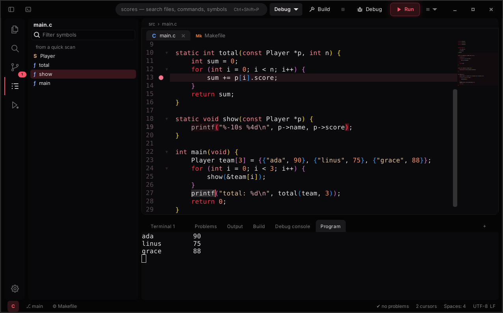

<p align="center">
  
</p>
<h1 align="center">Aether</h1>
<p align="center"><b>A fast IDE for Linux.</b> Build, run and debug — in a window that opens instantly.</p>
<p align="center">
  
  
  
  
</p>



Aether is written from scratch on GTK 4 and GtkSourceView 5, with no Electron and no VS Code code. It builds your project, takes you straight to the errors, and debugs C, C++, Rust and Go with gdb. It also has language servers, git, an outline, code folding, multiple cursors and 40+ themes.

## Install — one line, any distro

```bash
curl -fsSL https://raw.githubusercontent.com/rxvy-dev/aether/main/get.sh | bash
```

That's it. The script downloads Aether and installs what it needs with your distro's package manager (it asks once). Then it adds Aether to your app menu. Start it from there, or type `aether`.

Update later with `aether --update`. Remove it with `aether --uninstall`.

<details>
<summary><b>Prefer to clone it yourself?</b></summary>

```bash
git clone https://github.com/rxvy-dev/aether.git
cd aether
./install.sh
```
</details>

| Distro | Package manager | Tested |
|---|---|---|
| Arch, Manjaro, EndeavourOS, CachyOS, Artix, Garuda | pacman | package names checked |
| Debian 12+, Ubuntu 23.04+, Mint 22+, Pop!_OS 24+, elementary 8, Kali, MX | apt | ✔ full install + run |
| Fedora, RHEL / Alma / Rocky 9+ (with EPEL) | dnf | package names checked |
| Fedora Silverblue / Kinoite | rpm-ostree (or toolbox) | — |
| openSUSE Tumbleweed, Leap 15.6+ | zypper | package names checked |
| Void (glibc and musl) | xbps | package names checked |
| Alpine, postmarketOS | apk | package names checked |
| Gentoo | emerge (the installer tells you which USE flags) | — |
| NixOS | `nix-shell --run ./bin/aether` (uses `shell.nix`) | — |
| Solus, Mageia, Clear Linux | eopkg / urpmi / swupd (best effort) | — |

Installer options (they work after `get.sh | bash -s --` too):

```bash
./install.sh -y              # no questions
./install.sh --user          # install to ~/.local (Aether itself needs no sudo)
./install.sh --minimal       # only what's needed to start (skip gdb, compilers, git, terminal)
./install.sh --no-deps       # don't touch the package manager
./install.sh --print-deps    # show the package command for your distro without running it
./install.sh --check         # what's installed / missing  (same as: aether --doctor)
./install.sh --uninstall     # remove it
```

Don't want to install? Run it from the folder with `./bin/aether`.

### Requirements

- **Required:** Python 3.9+, PyGObject with its cairo bridge, GTK 4.8+, GtkSourceView 5.6+.
- **Recommended:** VTE for GTK 4 (terminal), gdb (debugger), gcc/clang + make, git.
- **Optional:** language servers (`clangd`, `pyright`, `rust-analyzer`, `gopls`, `typescript-language-server`…), `clang-format`, `black`/`ruff`, `rustfmt`, `prettier`, `shellcheck`.

Ubuntu 22.04 and Debian 11 ship GTK older than 4.8, so use 24.04 / Debian 12 or newer.

### Packages

| | Command |
|---|---|
| Debian / Ubuntu `.deb` | `make deb` → `dist/aether_3.0.0_all.deb` |
| Fedora / openSUSE `.rpm` | `make rpm` (uses `packaging/rpm/aether.spec`) |
| Arch | `make dist && cp dist/*.tar.gz packaging/ && cd packaging && makepkg -si` |
| Void | copy `packaging/void/template` to `void-packages/srcpkgs/aether/` and run `./xbps-src pkg aether` |
| Alpine | `packaging/alpine/APKBUILD` |
| Gentoo | `packaging/gentoo/aether-3.0.0.ebuild` (local overlay) |
| Source tarball | `make dist` |

## Screenshots

| Welcome | Multiple cursors, outline, bracket colours |
|---|---|
|  |  |

## Features

### Feels like VS Code, builds like Code::Blocks
- **VS Code-style workbench:**
  - An **activity bar** (Explorer, Search, Source Control with a change counter, Outline, Run & Debug, Settings). Click the active view to hide the sidebar.
  - **File-type icons** in the tree and on tabs.
  - **Bracket pair colours.**
  - A minimap.
  - A **status bar that turns red while debugging**.
- **Code::Blocks-style build toolbar:** a **Debug / Release** selector, plus Build, Stop, Debug and Run. Release switches to `-O2 -DNDEBUG` for single files, `build-release/` for CMake and Meson, `--release` for Cargo, and `ReleaseFast` for Zig.

### Projects and builds
- **Opens any folder and detects the build system:** Cargo, CMake, Meson, Makefile, Go modules, Zig, npm or Python.
- **Build with `Ctrl+Shift+B`:** output streams into the Build panel. Errors from gcc, clang, rustc/cargo, go, zig and Python tracebacks are clickable, and a failed build jumps to the first error.
- **Run with `F5`:** runs the project (or the current file, `Ctrl+F5`) in the built-in terminal. `Ctrl+Alt+B` lists all tasks: build, run, test, clean, configure.
- **New project** (`Ctrl+Alt+N`) creates a ready-to-build project from a template: C + Makefile, C + Meson, C++ + CMake, Python, Rust/Cargo, Go, web page or Bash. It can also create the git repo for you. **Clone repository** clones a git URL and opens it.
- **Override any command per project** in `.aether/project.json` (Palette → *Project settings*):
  ```json
  { "build": "make -j8", "run": "./build/app --verbose", "test": "make check",
    "clean": "make clean", "debug_program": "build/app", "debug_args": "--level 3" }
  ```

### Debugger (gdb)
- **Breakpoints:** `F9`, or click the gutter. Breakpoints are kept between sessions.
- **Debug with `F6`:** this builds first. A single C/C++/Rust/Go file is compiled with `-g -O0` automatically. In a project, Aether asks once which program to run and remembers it. With no breakpoints set, it pauses at `main()`.
- **Stepping:** step over `F10`, step into `F7`, step out `Shift+F7`, continue `F6`, stop `Shift+F6`, plus pause and restart.
- **The Debug sidebar** shows variables (structs and arrays expand), watch expressions, the call stack (click a frame to jump to it) and all breakpoints.
- **Program I/O:** your program's input and output run in their own *Program* terminal tab, so `scanf` works. The *Debug console* takes raw gdb commands (`print arr[3]`, `x/8xb ptr`, `info registers`…).

### Smarter editing
- **Code folding:** click ▾ in the gutter, or use `Ctrl+Shift+[` / `]`; fold all / unfold all with `Ctrl+Alt+[` / `]`. Folding works on braces, indentation (Python/YAML), Markdown headings and multi-line comments. It never changes the file.
- **Multiple cursors:**
  - `Ctrl+D` selects the word, then adds the next occurrence.
  - `Ctrl+Shift+L` selects all occurrences.
  - `Ctrl+Alt+↑/↓` adds a cursor on the line above or below.
  - `Alt+Click` adds a cursor anywhere.
  - Typing, deleting, Enter, arrow keys, copy/paste and undo all work at every cursor. `Esc` goes back to one cursor.
- **Outline** (`Ctrl+Alt+O`): symbols of the current file. It's nested when a language server is running, follows your cursor, and can be filtered.
- **Language servers:** diagnostics, go to definition (`F12` / `Ctrl+Click`), hover, completion, references and rename.
- Starter `main` for 34 languages, language-aware auto-indent, auto-pairs, snippets, formatters, split view, minimap, zen mode, find/replace with regex, search & replace across the project.

### Git
Branch in the status bar, file badges, a Git panel (stage, unstage, discard, diff, commit, pull/push) and change marks in the gutter.

### Looks
- 40+ themes (`Ctrl+K`). The default is **Aether Crimson** (black and red); **Obsidian**, **Synthwave**, **Cyberpunk** and **Abyss** are also new.
- A Theme Studio, VS Code theme import, and 4 layouts (islands, classic, flat, floating).
- Toasts for build and debug results, a live activity chip in the status bar, and a rotating tip on the welcome screen.
- In Preferences (`Ctrl+,`) you can set the accent colour, corners, density, opacity, fonts and ligatures, and rebind every key.

## Keys

| | |
|---|---|
| Command palette | `Ctrl+Shift+P` |
| Quick open | `Ctrl+P` |
| Go to symbol / line | `Ctrl+R` / `Ctrl+G` |
| Build / tasks | `Ctrl+Shift+B` / `Ctrl+Alt+B` |
| Run project / run file | `F5` / `Ctrl+F5` |
| Debug start/continue, stop | `F6`, `Shift+F6` |
| Step over / into / out | `F10` / `F7` / `Shift+F7` |
| Toggle breakpoint | `F9` |
| Next occurrence / all occurrences | `Ctrl+D` / `Ctrl+Shift+L` |
| Cursor above / below | `Ctrl+Alt+↑` / `Ctrl+Alt+↓` |
| Fold / unfold | `Ctrl+Shift+[` / `Ctrl+Shift+]` |
| Outline / debugger / files / git | `Ctrl+Alt+O` / `Ctrl+Alt+D` / `Ctrl+Shift+E` / `Ctrl+Shift+G` |
| Find / replace / in project | `Ctrl+F` / `Ctrl+H` / `Ctrl+Shift+F` |
| Comment, duplicate, move line | `Ctrl+/`, `Ctrl+Shift+D`, `Alt+↑/↓` |
| Terminal / new terminal | ``Ctrl+` `` / ``Ctrl+Shift+` `` |
| Zen mode / split | `F11` / `Ctrl+\` |

All of these can be changed in Preferences → Keys.

## Publishing your own copy

```bash
./publish.sh                 # creates github.com/<you>/aether, pushes, makes a v3.0.0 release with the .deb + tarball
./publish.sh --name myide    # different repo name   ·   --private   ·   --no-release
```
It installs and logs in to the GitHub CLI (`gh`) if needed. It also points every link (README, `get.sh`, packages, `aether --update`) at your repo. Without `gh`, it falls back to plain `git push`.

## Development

```bash
./bin/aether        # run from the source tree
make test           # unit tests (folding, gdb/MI parser, project detection, error parsing)
make check          # dependency doctor
```

Code map: `aether/window.py` (main window), `editor.py` (editor tab), `ide.py` (builds + debugger glue), `debugger.py` (gdb/MI client), `folding.py`, `multicursor.py`, `outline.py`, `project.py` (build systems, templates), `tasks.py` (Build panel), `welcome.py`, `sidebar.py`, `lsp.py` / `lspui.py`, `prefs.py`, `chrome.py` (CSS).

### Rename before you release
"Aether" is a working name. Run `tools/rename.sh "YourName"` once to rename the command, app ID, themes, icon and desktop files, then update `LICENSE` and `packaging/`.

## License
MIT
